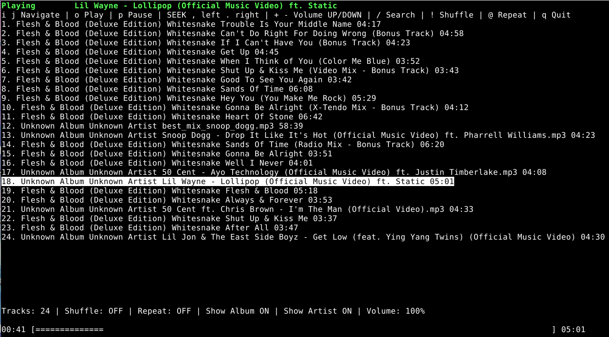
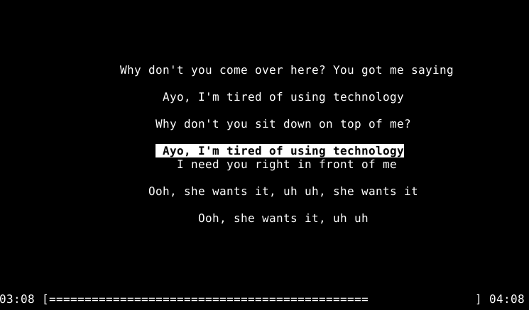
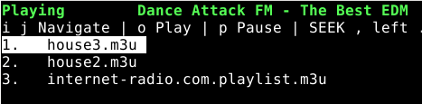

### Lyrics



### Online radio



### Albums and album cover


# 0verau

ncurses music player alternative to cmus

# Compile

```bash
make -j8  # 8 cores/threads to use in parallel compile
sudo/doas make install
```

### Listening to online radio

Start the program with your music folder: `0verau mp3/folder`. For online radio add a second argument, a folder with \*.m3u files: `0verau mp3/folder m3u/folder`. The most popular radio streams are at https://www.internet-radio.com/stations/house/ , download the \*.m3u file into that folder. To start playing the online stream press `SHIFT + ^` and it will list the `m3u` radio stations.

# Requirements

In Debian it's `sudo apt install libncurses5-dev libncursesw5-dev libsfml-dev libtag1-dev curl libcurl4-openssl-dev libvlc-dev libvlc-bin vlc`, in your other OS's search for `lib ncurses lib sfml lib tag  lib curl lib vlc vlc`.

SFML 2.6 or newer is needed (SFML 3 works too): older SFML can't play MP3 files.

---

# keybinds

You can specify your own keybings (before starting **0verau**) in `$HOME/0verau.conf` file:

```bash
# Specifying custom keybindings
UP=i
DOWN=j
PLAY=o
PAUSE=p
QUIT=q
REPEAT=@
SHUFFLE=!
SEARCH=/
VOLUMEUP=+
VOLUMEDOWN=-
SEEKLEFT=,
SEEKRIGHT=.
SHOW_HIDE_ALBUM=$
SHOW_HIDE_ARTIST=#
SHOW_HIDE_LYRICS=%
SHOW_HIDE_ONLINE_RADIO=^
NEXT_SONG=&
PREVIOUS_SONG=*
# pressing FAVOURITE again removes the song entry
FAVOURITE=f
SHOW_HIDE_FAVOURITES=F
GOTO=:
QUEUE=a
SORT=s
EXPORT_FAVOURITES=E
SHOW_HIDE_SIDEBAR=g
# in the album list, Enter plays the album and the right arrow goes to its songs
# switch between the album list and the songs
SWITCH_FOCUS=TAB
SHOW_HIDE_ART=c
```

A comment must be on its own line: `#` is a key too. `ENTER`, `SPACE` and `TAB` name those keys.

# Saved files

- `~/.config/0verau/state.conf`: volume, shuffle, repeat, sort order, the selected album, and the last song with the point where it stopped (it starts there, paused, at the next start). Saved when you change them and when you quit.
- `~/.config/0verau/favourites.txt`: your favourite songs and stations.
- `~/.cache/0verau/`: the song list of each music folder, so the next start doesn't read every file again.
- `song.mp3.lrc` next to a song: its downloaded lyrics.

`$XDG_CONFIG_HOME` and `$XDG_CACHE_HOME` are used when they are set.

---

When searchin  `/` (key pressed) for a song with the search key and type the desired name/album, to get back to the menu with songs, press `/` again followed by `enter` key (don't type anything).